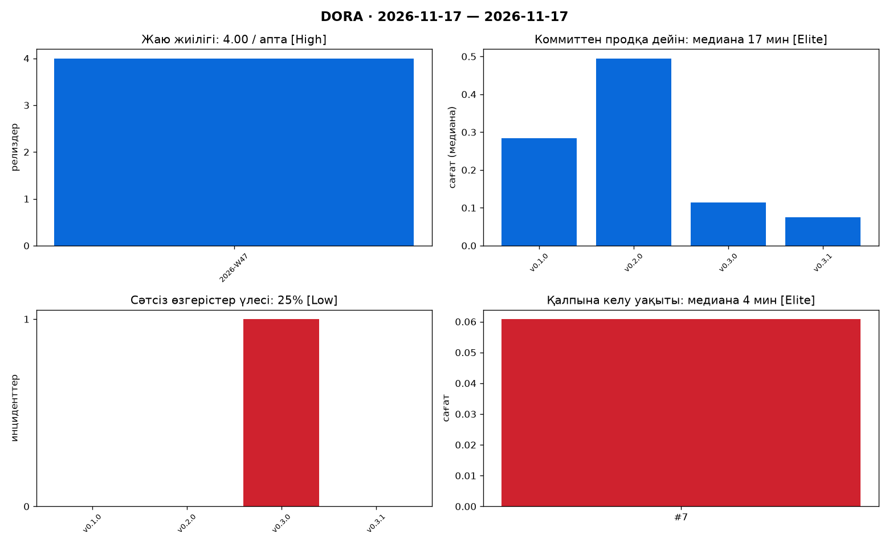

# DORA метрикаларын талдау және жақсартулар

ЗС 10, 4-тапсырма. Деректер репозиторийдің нақты тарихынан GitHub API арқылы жиналды:
[`scripts/dora.py`](../scripts/dora.py), нәтижелері — [`docs/dora/report.md`](dora/report.md),
[`docs/dora/data.json`](dora/data.json). Анықтамалар — [`docs/dora.md`](dora.md).

## 1. Бастапқы деректер

| Релиз | Жарияланды (UTC) | Коммиттер | Коммиттен продқа (мин) | Инцидент |
|---|---|---|---|---|
| v0.1.0 | 2026-11-17 18:37 | 4 | 2–30 | — |
| v0.2.0 | 2026-11-17 19:18 | 4 | 23–36 | — |
| v0.3.0 | 2026-11-17 19:20 | 2 | 5–8 | **#7** (P1, деректер жоғалуы) |
| v0.3.1 | 2026-11-17 19:28 | 2 | 2–7 | — (#7 түзетуі) |

Инцидент #7: ашылды 19:22:47, жабылды 19:26:26 → 3,7 минут.
Бақылау кезеңі: 18:07 (репозиторий жасалды) — 19:29, яғни **1 сағат 22 минут**.

## 2. Ағымдағы деңгей

| Метрика | Мәні | Деңгей | Түсіндірме |
|---|---|---|---|
| Жаю жиілігі | 4 релиз / апта | High | Төрт релиз 1,5 сағатқа сыйды. Скрипт кезеңді кемінде бір апта деп санайды, сондықтан 4/апта — төменгі шек. Шын ырғақ релиз жоспарымен анықталады: аптасына 2 терезе |
| Коммиттен продқа дейінгі уақыт | медиана 17 мин | Elite | Оқу жобасының қысқартылған кестесінің салдары. Терезелермен (сейсенбі/бейсенбі) күтілетін мән — 1–3 күн, яғни **High** |
| Сәтсіз өзгерістер үлесі | 25% (4-тен 1) | **Low** | Нақты сигнал: P1 ақауы (жаңартқанда деректер жоғалады) CI-дің төрт тексеруінен де, релиз чек-парағынан да өтіп кетті |
| Қалпына келу уақыты | 3,7 мин | Elite | Шамадан тыс жақсы: issue мерж кезінде автоматты жабылды (коммиттегі `Fix #7`), ал табу уақыты тіркелмеді. Шын уақыт = табу + түзету + релиз ≈ 6–10 мин |

### Деректердің шектеулері

- **Тарих өте қысқа:** 4 релиз, 1 инцидент. Бір инцидент сәтсіз өзгерістер үлесін 0%-дан 25%-ға өзгертеді, сондықтан метрикалар статистикалық тұрғыдан әлі тұрақсыз. Деңгейлер бағдар ретінде ғана берілген. Тапсырмада айтылғандай, қысқа тарих та бақылау нәтижесі болып табылады.
- **Бір әзірлеуші:** ревью мен кезекшілік бір адамда, сондықтан командалық процестің әсері көрінбейді.
- **Продакшен жоқ:** «жаю» = GHCR-де бейнесі бар GitHub Release. Пайдаланушылар трафигі жоқ, инцидент жаю процедурасын талдау кезінде табылды (game day).
- **Терезеден тыс релиздер:** v0.2.0, v0.3.0 және v0.3.1 релиз иесінің шешімімен терезеден тыс шықты ([релиз журналы](release-plan.md#10-релиз-журналы)). Сондықтан алғашқы екі метрика процестің шын ырғағын көрсетпейді.
- GitHub репозиторийі жасалғанға дейінгі коммиттер (`since=created_at`) коммиттен продқа дейінгі уақытқа кірмейді.

**Қорытынды:** ең әлсіз әрі ең сенімді метрика — **сәтсіз өзгерістер үлесі**. Жылдамдыққа қатысты метрикаларды шын ырғақпен 3–4 апта бақылағаннан кейін ғана бағалау керек.

## 3. Екі жақсарту

### Жақсарту 1. CI-ге «жаңарту тесті» қосу — сәтсіз өзгерістер үлесі үшін

**Мәселе.** #7 ақауы кодта емес, контейнердің өмірлік циклінде болды: деректерді `/data`-да сақтау үшін том керек. CI-дегі тексерулердің ешқайсысы «ескі нұсқа → жаңа нұсқа» жаңартуын тексермейді. Smoke-тест жаңа контейнерді таза күйде іске қосады.

**Не істейміз.** `ci.yml`-ге `upgrade-test` job қосылады:

1. Соңғы релиздің бейнесін (`ghcr.io/…/helpdesk:latest`) атаулы томмен іске қосу.
2. API арқылы 3 өтінім жасау.
3. Контейнерді жою және жаңа бейнені **сол томмен** іске қосу (дәл продакшендегідей).
4. Өтінімдер сақталғанын және `/health` → `"persistent_storage": true` екенін тексеру.

Бұл job міндетті тексерулерге (branch protection) қосылады.

**Күтілетін әсер.** Деректердің сақталуы мен дерекқор сұлбасының көшірілуіне байланысты ақаулар (expand → contract ережесін бұзу да) релизге дейін ұсталады. Мақсат — келесі 10 релизде сәтсіз өзгерістер үлесі **≤ 15% (Medium)**, кейін **≤ 10% (High)**. CI уақыты шамамен 30–40 секундқа ұзарады.

**Қалай өлшейміз.** Әр дүйсенбі `DORA dashboard` workflow-ы. Сонымен бірге `upgrade-test` неше рет құлағаны: әр құлау — продакшенге жетпеген ақау.

### Жақсарту 2. Инциденттерді табуды және тіркеуді автоматтандыру — қалпына келу уақыты үшін

**Мәселе.** Қалпына келу уақыты дұрыс өлшенбейді. Issue мерж кезінде жабылды, ал түзету тек 2 минуттан кейін продакшенге шықты. Мәселе қашан пайда болғаны мүлде белгісіз. Мониторинг жоқ: #7 сияқты ақауды пайдаланушы деректерін жоғалтқаннан кейін ғана білер едік.

**Не істейміз.**

1. Uptime Kuma (11-ЗЖ) `/health`-ты әр 60 секунд сайын тексереді: қолжетімділік + `"persistent_storage": true` кілт сөзі. Алерт команда арнасына жіберіледі.
2. Коммиттер мен PR-ларда `Fix #N` орнына `Refs #N` жазылады. Инцидент issue **түзету релизі шыққаннан кейін** және `/health` тексерілгеннен кейін ғана қолмен жабылады. Бұл ереже релиз жоспарына қосылады.
3. Incident шаблонына «Мәселе басталған уақыт» және «Алерт келген уақыт» өрістері қосылады. Скрипт қалпына келу уақытын issue ашылған сәттен емес, мәселе басталған уақыттан бастап есептейді.

**Күтілетін әсер.** Қалпына келу уақыты шынайы болады (табу уақыты да кіреді). #7 сияқты ақауды табу пайдаланушы шағымынан (сағаттар/күндер) мониторингпен **1–2 минутқа** дейін қысқарады. Мақсат — қалпына келу уақыты **< 1 сағат (Elite)** шынайы өлшеммен сақталады.

**Қалай өлшейміз.** Инциденттердегі «алерт келген уақыт − мәселе басталған уақыт» (табу уақыты) және `DORA dashboard`-тағы қалпына келу уақыты.

## 4. Келесі қадамдар

| Не | Кім | Қашан |
|---|---|---|
| `upgrade-test` job | Almas | келесі спринт |
| Uptime Kuma + `persistent_storage` алерті | Almas | 11-ЗЖ |
| `Refs #N` ережесі және жаңа өрістер Incident шаблонында | Almas | келесі спринт |
| DORA-ны терезелер ырғағымен 3–4 апта бақылап, деңгейлерді қайта бағалау | Almas | 2026-12-15 дейін |
