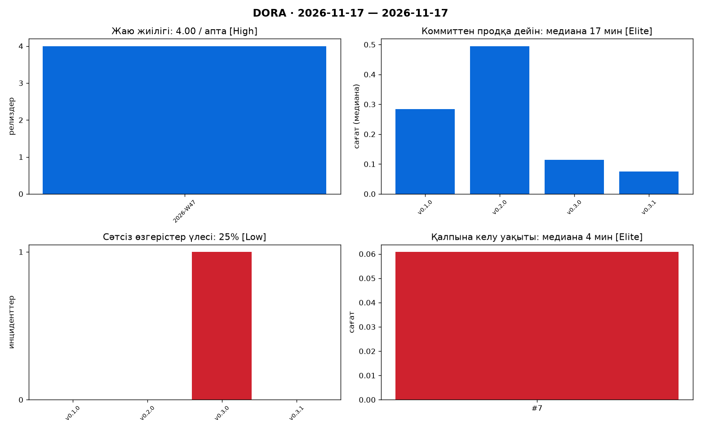

# DORA метрикалары — southkz0717-source/helpdesk

Кезең: 2026-11-17 — 2026-11-17. Релиздер: 4. Ашық инциденттер: 0.
Есептелген уақыты: 2026-11-17 19:29 UTC.

| Метрика | Мәні | Деңгей |
|---|---|---|
| Жаю жиілігі (Deployment frequency) | 4.00 релиз / апта | High |
| Коммиттен продқа дейінгі уақыт (Lead time) | 17 мин | Elite |
| Сәтсіз өзгерістер үлесі (Change failure rate) | 25% | Low |
| Қалпына келу уақыты (Time to restore) | 4 мин | Elite |

